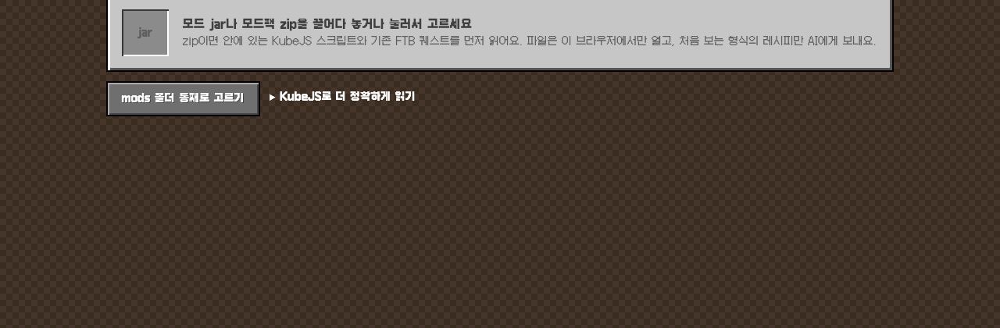
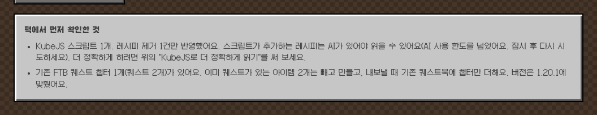
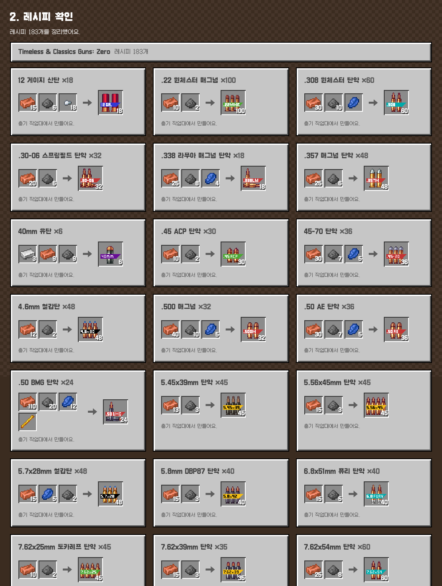
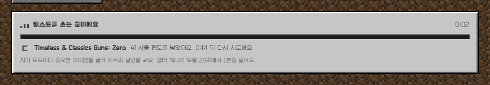
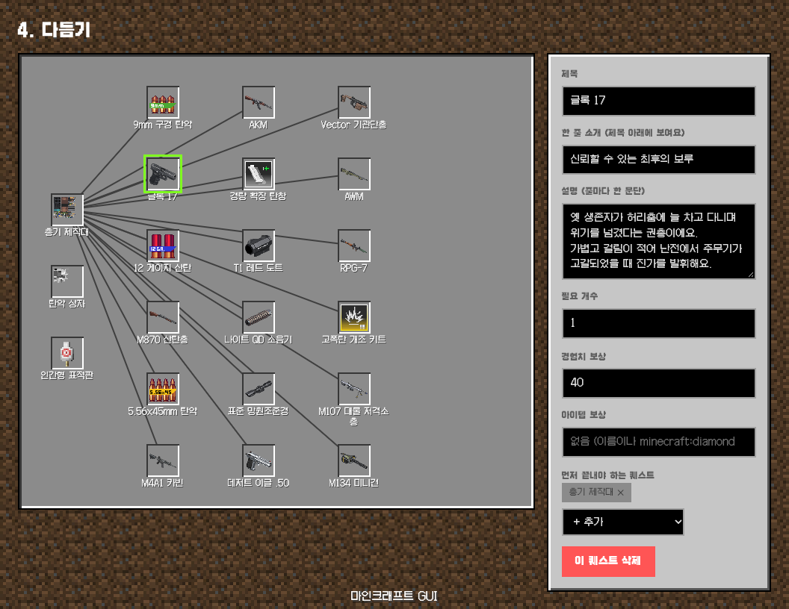
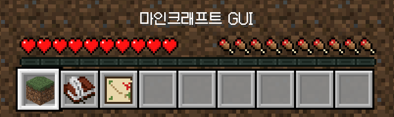
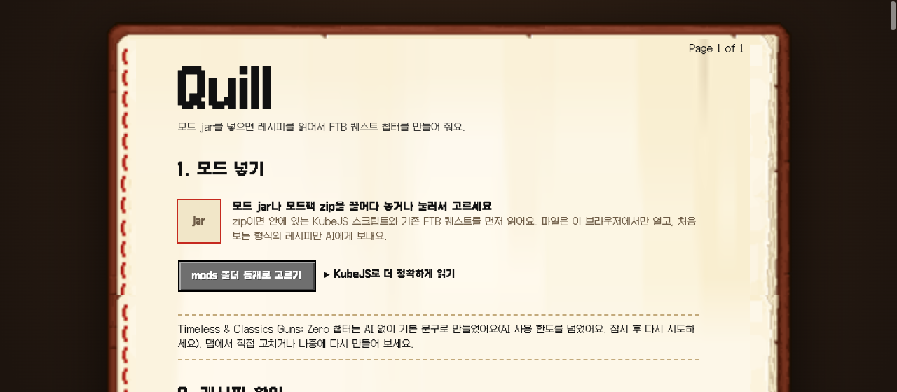
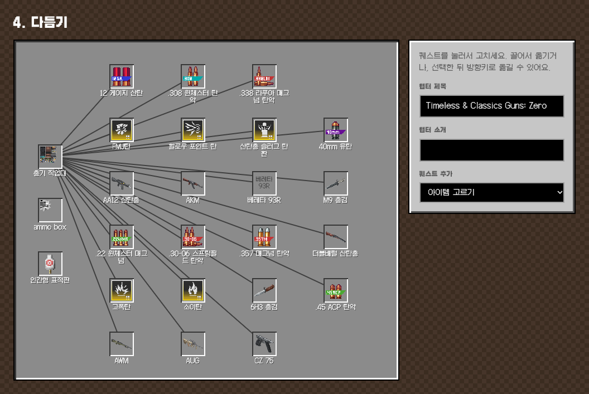
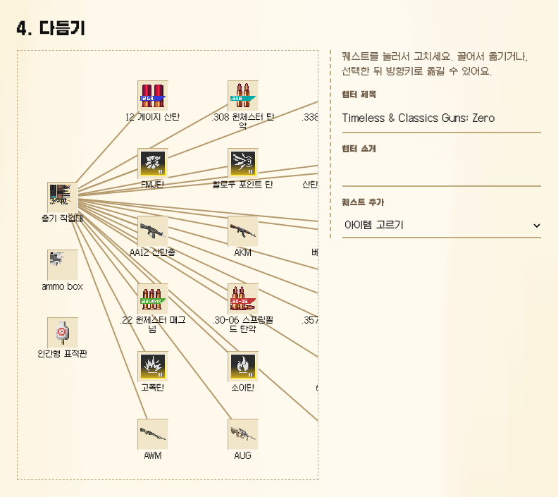
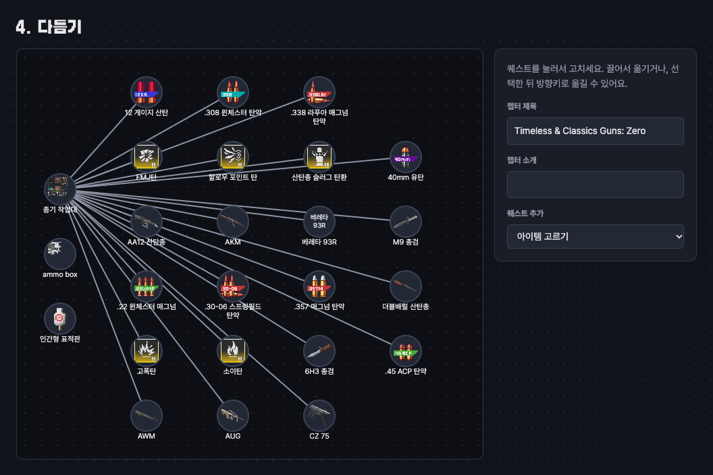

# Quill

**모드 jar를 넣으면 FTB 퀘스트 챕터가 나옵니다.**

바로 써 보기: **https://quill-gray.vercel.app**

직접 섞어 만든 마인크래프트 모드팩에는 퀘스트가 없습니다. FTB Quests 에디터에서 퀘스트를 하나하나 만드는 건 팩 제작에서 가장 지루한 일입니다. Quill은 모드의 레시피를 읽어서 "무엇을 만들어야 무엇을 만들 수 있는지" 진행 순서를 계산하고, 그 순서대로 퀘스트 챕터를 만들어 줍니다.



## 이렇게 동작합니다

### 1. 모드 넣기

모드 jar, `mods` 폴더 통째로, 또는 모드팩 zip을 넣습니다. 아직 jar가 없으면 "jar 없이 예시로 먼저 보기"를 누르세요. 바닐라 아이템으로 만든 예시 챕터가 바로 열려서, 키 없이 편집과 내보내기까지 해 볼 수 있습니다.

zip이면 퀘스트를 만들기 전에 팩이 이미 가진 것부터 확인합니다.

- **KubeJS 스크립트**: 레시피를 지우거나 추가한 부분을 찾아서 반영합니다.
- **KubeJS 데이터팩 레시피**: 같이 읽습니다.
- **기존 FTB 퀘스트**: 이미 퀘스트가 있는 아이템은 빼고 만들고, 기존 퀘스트북에 챕터만 더합니다.
- **마인크래프트 버전**: 기존 퀘스트 파일이나 팩 정보에서 읽어서 자동으로 맞춥니다.



### 2. 레시피 확인

jar는 브라우저 안에서만 열고, 레시피와 이름, 아이콘 파일만 꺼냅니다. 서버로 올리지 않습니다.

- 작업대, 화로, 석재 절단기, 대장장이 작업대처럼 형식이 정해진 레시피, TACZ 총기 레시피, Create의 기계 레시피(분쇄, 압착, 혼합 등)는 코드로 바로 변환합니다. Create는 레시피 1,766개 중 97%를 AI 없이 읽습니다.
- 모드가 다른 모드를 위해 넣어 둔 레시피(예: Mekanism이 있을 때만 생기는 우라늄 분쇄)는 그 모드가 없으면 뺍니다. 게임과 같은 규칙입니다.
- 처음 보는 형식만 AI(Gemini)에게 보내서 하나의 형식으로 정리합니다.
- AI가 만든 결과에 모드에 없는 아이템이 있으면 빨간 칸으로 표시합니다.
- 바닐라 아이템은 한국어 이름과 아이콘으로 보여 줍니다.



### 3. 퀘스트 만들기

레시피로 진행 트리를 만들고, AI가 모드마다 중요한 아이템을 골라 퀘스트 제목, 설명, 보상을 씁니다. 작업대 같은 제작 장소도 선행 조건으로 계산합니다.

퀘스트 문구는 사용 설명서보다 게임처럼 씁니다. 제목 아래에는 눈에 띄는 한 줄 소개가 붙습니다. 그 아래 설명은 스타일을 고를 수 있습니다.

| 설명 스타일 | 내용 |
|---|---|
| 섞어서 | 짧은 이야기, 도전, 농담, 실전 팁을 번갈아 써서 같은 말투가 이어지지 않습니다 |
| 서사적 | 챕터 전체가 하나의 이야기로 이어지고, 깊은 단계일수록 절정으로 갑니다 |
| 설명 | 이야기 없이 용도, 지금 필요한 이유, 만드는 법을 씁니다 |
| 유머 | 아이템이나 노가다를 비꼬는 농담 |

어느 스타일이든 만드는 법은 마지막 줄에 짧게 붙습니다.

> **M95 대물저격총**: 스치기만 해도 박살 난다.
> 단단한 껍질을 두른 괴물조차 흔적도 없이 날려버리는 파괴의 결정체예요.

만드는 동안에는 지금 어느 모드를 처리하는지, 얼마나 걸렸는지, AI 한도에 걸려 몇 초 뒤에 다시 시도하는지 보여 줍니다.



AI 키가 없거나 한도를 넘으면, 많이 쓰이는 아이템 위주로 골라서 아이템 이름만 제목으로 넣습니다. 소개와 설명은 비워 두니 4단계에서 직접 쓰면 됩니다.

### 4. 다듬기

FTB 퀘스트북과 비슷한 맵에서 퀘스트를 끌어서 옮깁니다.

- 제목, 한 줄 소개, 설명, 필요 개수, 경험치, 아이템 보상, 선행 퀘스트를 고치고, 퀘스트를 추가하거나 지웁니다.
- 마음에 안 드는 퀘스트 하나만 "AI로 다시 쓰기"로 새로 쓸 수 있고, "더 웃기게" 같은 부탁도 같이 보낼 수 있습니다.
- 과제는 아이템 얻기 말고도 몹 처치, 차원 가기, 구조물 찾기, 바이옴 찾기, 체크 표시로 바꿀 수 있습니다.
- "게임에서 보이는 모습"에 퀘스트 화면을 미리 보여 줍니다. `&6` 같은 마인크래프트 색 코드도 그대로 보입니다.
- 필요 아이템을 누르면 조합법이 보이고, 재료를 누르면 그 재료의 조합법으로 따라 들어갑니다.
- 다른 챕터의 퀘스트도 선행 퀘스트로 걸 수 있고, 챕터 순서를 바꿀 수 있습니다.
- 되돌리기(Ctrl+Z), 다시 하기, 자동 정렬이 있습니다.
- 작업은 브라우저에 자동으로 저장되어, 새로고침해도 이어서 할 수 있습니다.



### 5. 내보내기

zip을 받아 인스턴스 폴더에 풀면 `config/ftbquests/quests/` 안에 들어갑니다.

## 테마

화면 아래의 핫바에서 아이템을 누르거나 숫자 키 1~3을 눌러 바꿉니다. 게임처럼 바꾼 테마 이름이 핫바 위에 잠깐 뜨고, Quill이 작업하는 동안에는 경험치 바가 차오릅니다.



| 슬롯 | 테마 |
|---|---|
| 1. 잔디 블록 | **마인크래프트 GUI**: 위에 잔디, 아래에 흙이 깔린 배경 위에 회색 인벤토리 창 |
| 2. 책 | **책과 깃펜**: 화면 전체가 책과 깃펜의 한 페이지이고, 모든 내용을 그 위에 쓴 것처럼 보입니다 |
| 3. 지도 | **FTB 퀘스트 맵**: 어두운 퀘스트북 화면에 원형 퀘스트 노드 |



| 마인크래프트 GUI | 책과 깃펜 | FTB 퀘스트 맵 |
|---|---|---|
|  |  |  |

## 지원 범위

| | 내용 |
|---|---|
| 출력 버전 | FTB Quests 1.20.1 (Forge, Fabric), 1.21.1 (NeoForge, Fabric) |
| 1.21.1 차이 | 제목과 설명을 `quests/lang/*.snbt`에 따로 씁니다 |
| NBT 아이템 | TACZ의 총, 탄약, 부착물은 NBT까지 맞춰서 퀘스트 과제로 만듭니다 |
| 입력 | `.jar`, `mods` 폴더, 모드팩 `.zip` / `.mrpack`, KubeJS 덤프 `.json` |

출력 파일 형식은 [FTB-Quests](https://github.com/FTBTeam/FTB-Quests) 소스 코드(`1.20.1/main`, `1.21.1/main`)의 저장 코드와 대조해서 맞췄습니다.

### KubeJS로 더 정확하게 읽기

jar만으로는 모드가 코드로 등록하는 레시피와 팩이 KubeJS로 바꾼 레시피를 다 알 수 없습니다. 앱에서 받을 수 있는 `quill_export.js`를 팩의 `kubejs/server_scripts/`에 넣고 월드에 들어가면, 게임이 실제로 쓰는 레시피 전체가 `kubejs/exported/quill.json`으로 저장됩니다. 이 파일을 Quill에 넣으면 됩니다.

## 알려진 한계

- **게임 검증**: 만든 퀘스트를 실제 게임에서 불러오는 테스트는 아직 하지 못했습니다. 파일 형식은 FTB Quests 소스와 대조했고 자동 테스트로 확인합니다.
- **KubeJS 덤프 스크립트**: KubeJS 6(1.20.1)용 실험 기능입니다.
- **AI 무료 한도**: Gemini 무료 키는 모델마다 하루 20번까지만 부를 수 있습니다. 다 쓰면 바로 알려 주고 AI 없이 만듭니다.
- **CurseForge, Modrinth 내보내기 zip**: 모드 목록만 담고 jar는 없습니다. 설치한 인스턴스의 `mods` 폴더를 같이 넣어야 합니다.
- **태그 재료 아이콘**: `#forge:ingots/iron` 같은 태그 재료의 아이콘은 이름 규칙으로 추측합니다.

## AI와 개인정보

- jar와 zip은 브라우저 밖으로 나가지 않습니다.
- AI가 필요할 때는 레시피 JSON, KubeJS 스크립트, 아이템 이름 목록만 서버를 거쳐 Gemini로 보냅니다.
- 배포된 Quill은 서버의 API 키를 쓰지 않습니다. 3단계에서 AI를 고르고 내 키를 넣어야 AI를 씁니다.

  | AI | 무료로 쓰는 법 |
  |---|---|
  | Google Gemini | [Google AI Studio](https://aistudio.google.com/apikey) 무료 키. 모델마다 하루 20번 |
  | OpenRouter | [무료 모델](https://openrouter.ai/models?q=free)(`:free`). 하루 50번, 10달러를 한 번 충전한 계정은 1,000번 |
  | Zhipu GLM | 무료 모델 `glm-4.7-flash`. 데이터가 중국 서버로 갑니다 |

  서버는 이 세 곳의 정해진 주소로만 요청을 보냅니다.
- 키는 그 브라우저에만 저장됩니다. 키가 없어도 AI 없이 만들 수 있습니다(제목만 들어가고 설명은 직접 씁니다).
- 같은 요청에 대한 AI 결과는 브라우저(IndexedDB)에 저장해 두고 다시 쓰므로, 같은 모드를 다시 넣으면 AI를 다시 부르지 않습니다.

## 직접 실행하기

```bash
npm install
echo "GEMINI_API_KEY=..." > .env.local   # 로컬 개발에서만 쓰는 서버 키
npm run dev
```

테스트:

```bash
for f in lib/*.check.ts; do node --experimental-strip-types $f; done
```

## 구조

```
app/page.tsx                 화면 흐름 (넣기 → 확인 → 만들기 → 다듬기 → 내보내기)
app/components/              슬롯, 퀘스트 맵 편집기, 진행 상황 패널
app/api/normalize            처음 보는 레시피 형식 → 표준 형식 (Gemini)
app/api/quests               퀘스트 고르기와 문구 쓰기 (Gemini)
app/api/kubejs               KubeJS 스크립트의 레시피 변경 읽기 (Gemini)
app/api/rewrite              퀘스트 하나 다시 쓰기 (AI)
lib/ai.ts                    AI 제공자 (Gemini, OpenRouter, Zhipu GLM)
lib/jar.ts, lib/pack.ts      jar, 모드팩 zip 읽기 (브라우저)
lib/convert.ts               형식이 정해진 레시피 변환 (AI 없이)
lib/tree.ts                  진행 트리, 퀘스트 의존 관계, 맵 배치
lib/snbt.ts                  FTB Quests SNBT 쓰기와 읽기
lib/conditions.ts            레시피 로드 조건 (설치 안 된 모드용 레시피 빼기)
lib/demo.ts                  jar 없이 보는 예시 챕터
```

Next.js 16, React 19, [fflate](https://github.com/101arrowz/fflate), Google Gemini를 씁니다.

## 출처

- 바닐라 아이콘: [PrismarineJS/minecraft-assets](https://github.com/PrismarineJS/minecraft-assets)
- 바닐라 한국어 이름: [InventivetalentDev/minecraft-assets](https://github.com/InventivetalentDev/minecraft-assets)
- 두 자료 모두 실행할 때 불러오고 저장소에는 넣지 않습니다. 마인크래프트 리소스의 권리는 Mojang에 있습니다.
- 테마 그림(`public/theme/`): 핫바, 잔디 블록, 흙, 책, 책과 깃펜 화면을 마인크래프트 원래 픽셀 크기로 잘라 만들었습니다. 지도 아이콘은 직접 그렸습니다.
- 픽셀 글꼴: [갈무리](https://github.com/quiple/galmuri)
- Quill은 Mojang, FTB, KubeJS와 관계없는 비공식 도구입니다.
